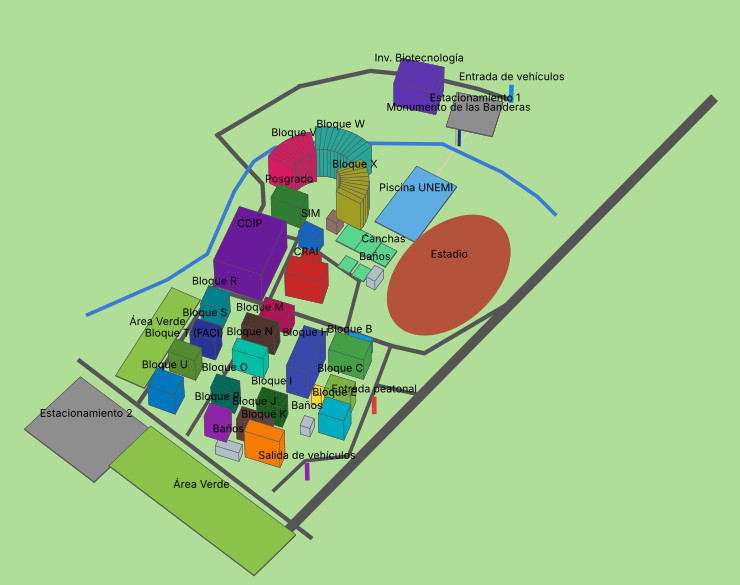

# Campus UNEMI 3D para Unity

Genera el campus de la Universidad Estatal de Milagro en 3D con un clic, con una **personita
que camina por las calles** hasta el destino que calcula UNEMI Guide AI.



## Abrir el proyecto (2 minutos)

1. Abre **Unity Hub → Add → Add project from disk** y elige esta carpeta (`unity`).
   Unity crea solo las carpetas `Library`, `Packages` y `ProjectSettings`.
   *(Otra opción: crea un proyecto 3D nuevo y copia `Assets/UNEMI` dentro de su `Assets`.)*
2. Espera a que Unity compile (abajo a la derecha deja de girar el ícono).
3. Menú de arriba: **UNEMI → Generar Campus 3D**. Esto:
   - construye el campus,
   - crea la **personita**, la **línea amarilla de la ruta**, la **meta** y el objeto **RouteAnimator**,
   - prepara la cámara y la luz,
   - guarda la escena en `Assets/UNEMI/Escenas/CampusUNEMI.unity` y la agrega al Build.
4. Dale **Play**: la personita sale de la *Entrada peatonal* y camina hasta el **aula K-301**.

Funciona con Built-in, URP y HDRP, y con el Input Manager viejo o el nuevo Input System.

### Controles

| Acción | PC | Celular |
|---|---|---|
| Mover el mapa | clic izquierdo + arrastrar · WASD (vista libre) | 1 dedo |
| Girar | clic derecho + arrastrar · Q / E | 2 dedos girando |
| Zoom | rueda | pellizcar |
| Seguir a la personita / vista libre | **F** o botón del panel | botón del panel |
| Mover a la personita (cuando llegó y la cámara la sigue) | WASD / flechas | — |

El panel de arriba a la izquierda muestra la indicación, los metros que faltan, los botones
**Pausar / Repetir / Seguir** y los FPS (verde = 30 FPS o más).

## Qué se genera

Dentro del objeto `UNEMI_Campus` (pasto verde, cielo celeste y nombres en carteles blancos):

| Grupo | Contenido |
|---|---|
| Bloques | B, C, E, H, I, J, **K (naranja, con el pin del aula K-301)**, M, N, O, P, R, S, T (FACI), U, V, W, X, CDIP, SIM, Posgrado, **CRAI**, Bloque de Investigación de Biotecnología. Cada edificio tiene un color distinto. |
| Baños | Los 3 baños del mapa, en gris claro |
| Deportes | Estadio Universitario, Piscina UNEMI, canchas |
| Estacionamientos | Estacionamiento 1 y Estacionamiento 2 |
| Areas Verdes | Detrás de R, S, T, U y debajo del bloque U |
| Calles y Senderos | Avenida 17 de Septiembre, calles internas, vía de acceso vehicular, sendero Piscina → Monumento → Estacionamiento 1 y **paseos peatonales** (beige) entre los bloques: Paseo central, Paseo de los bloques y los pasos junto a H, I, K y hacia la Piscina |
| Estero | Estero de Belín |
| Accesos | Entrada peatonal (roja), Entrada de vehículos (azul) y Salida de vehículos (morada) |
| Monumentos | Monumento de las Banderas, con 3 astas |
| **Personita** | Personaje 3D con camisa azul y mochila naranja, aro amarillo y cartel «Tú». Mueve piernas y brazos al caminar. |
| **RouteAnimator** | Recibe la ruta de la web / Django (`RutaCampus`) y trae el `ApiClient` |
| **Linea de la ruta / Meta** | Línea amarilla del camino y aro rojo en el punto de llegada |

Unidades en **metros**. Eje **X = Este**, eje **Z = Norte**, origen en el centro del campus.

### Ids para buscar desde código

`K`, `K-301`, `B`, `C`, `E`, `H`, `I`, `J`, `M`, `N`, `O`, `P`, `R`, `S`, `T`, `U`, `V`, `W`, `X`, `CDIP`, `SIM`, `POSGRADO`, `CRAI`, `BIOTEC`, `BANOS_1`, `BANOS_2`, `BANOS_3`, `PISCINA`, `ESTADIO`, `CANCHA1`…`CANCHA5`, `PARQ1`, `PARQ2`, `VERDE1`, `VERDE2`, `ENTRADA_PEATONAL`, `ENTRADA_VEHICULOS`, `SALIDA_VEHICULOS`, `MONUMENTO`.

## Cómo se conecta con UNEMI Guide AI

```
campus_data.py ──gen_cs.py──►  CampusData.cs            (Unity)
                └────────────►  campus_unemi.json        (web + Django)
                                     │
               python manage.py cargar_campus  →  zonas, destinos, calles (pasillos), rutas
                                     │
Django /api/rutas/calcular/ (Dijkstra por las calles) → "escena" → Unity: RouteAnimator.LoadWaypoints(json)
```

La escena viene en metros con el **mismo (0, 0) del modelo 3D** (X = este, Z = sur), así que
Unity sigue el camino de Django tal cual (en Unity `z = -z`). Si la ruta viniera vacía, Unity
busca el destino por nombre y camina por las calles con su propio Dijkstra (`GrafoCalles.cs`).

### Mostrar Unity dentro de la web

Sin build de Unity, la web dibuja este mismo campus con Three.js. Para que muestre **Unity**:

1. **File → Build Settings → WebGL → Switch Platform**.
2. **Player Settings → Publishing Settings → Compression Format: Disabled**.
3. **Build** y elige una carpeta llamada **`unemi`** (los archivos salen como `unemi.loader.js`,
   `unemi.data`, `unemi.framework.js`, `unemi.wasm`).
4. Copia el contenido de `unemi\Build\` a `backend\web\static\web\unity\Build\`.
5. Reinicia `runserver`. La pantalla «Recorrido en 3D» carga Unity sola y le envía la ruta.

- **Unity WebGL dentro de la web:** `backend/web/static/web/js/simulacion.js` envía la ruta con
  `unityInstance.SendMessage("RouteAnimator", "LoadWaypoints", json)`, y también `SetVelocidad`,
  `Pause`, `Resume` y `Replay`. Por eso el objeto se debe llamar exactamente **RouteAnimator**.
- **Ir directo a un lugar:** `SendMessage("RouteAnimator", "IrA", "CDIP")`.
- **Unity de escritorio:** el `ApiClient` (en RouteAnimator) llama a Django:

```csharp
using UNEMI.Campus;

var api  = FindObjectOfType<ApiClient>();
var ruta = FindObjectOfType<RutaCampus>();
api.CalculateRoute(origenId, destinoId, r => ruta.LoadRoute(r), error => Debug.LogWarning(error));
```

Copia en el Inspector del `ApiClient` las cookies `sessionid` y `csrftoken` del navegador
(F12 → Aplicación → Cookies) después de iniciar sesión en la web.

**Nombres:** si un nombre del admin de Django no existe en el campus 3D, agrégalo en
`RutaCampus → Alias` con el formato `Nombre en Django=Id en Unity` (ya vienen
`Bloque A=T`, `Biblioteca Central=CRAI` y `FACI=T`). Solo se usa si Django manda la ruta vacía.

**Demo:** en `RouteAnimator → Ruta Campus` puedes apagar *Demo Al Iniciar* o cambiar *Demo Destino*.

### Otras funciones útiles

```csharp
var destino = CampusLocation.Buscar("K-301");      // también "K", "CDIP", "PARQ1", "Bloque H"...
Vector3 punto = destino.PosicionDestino;

var geo = FindObjectOfType<CampusGeoReference>();   // GPS real → posición en el mapa 3D
Vector3 yo = geo.GpsAUnity(Input.location.lastData.latitude, Input.location.lastData.longitude);

Camera.main.GetComponent<CampusCameraController>().EnfocarEn(punto, 120f);
```

### Calibrar el GPS (una vez)

1. Selecciona `UNEMI_Campus` → componente **Campus Geo Reference**.
2. En Google Maps haz clic derecho sobre el centro del **Bloque K** → copia las coordenadas → pégalas en *Punto A*.
3. Haz lo mismo con el centro del **Estadio** en *Punto B*.

Menú extra: **UNEMI → Exportar lugares a JSON** crea `Assets/UNEMI/lugares_campus.json` con todos
los lugares (y su latitud/longitud si ya calibraste). Sirve para cargar las zonas en el admin de Django.

## Corregir posiciones

- Rápido: mueve cualquier bloque en la escena de Unity (todo lo que cuelga de él se mueve junto).
- Permanente: edita los números en `Assets/UNEMI/Scripts/CampusData.cs` y vuelve a usar *Generar Campus 3D*.
- Desde el plano: `herramientas/campus_data.py` tiene todo medido en píxeles. En PowerShell:

```powershell
python herramientas\gen_cs.py
```

  regenera `CampusData.cs` **y** `backend/web/static/web/data/campus_unemi.json`. Después ejecuta
  `python manage.py cargar_campus` (en `backend`) para que Django use los datos nuevos.
  Las calles de ahí son el grafo por el que camina la personita.

> **Por dónde camina el peatón:** por las calles internas, los senderos y los paseos
> peatonales (estilo `"peatonal"` en `campus_data.py`). La Avenida 17 de Septiembre NO se usa
> para caminar porque está fuera del campus.
>
> Los paseos peatonales y el sendero que pasa debajo de los baños del Bloque K **son
> supuestos**: no estaban en el plano. Se trazaron revisando que no crucen ningún edificio.
> Si alguno no existe en el campus real, bórralo de `campus_data.py` y vuelve a generar.

Para cambiar el color de un edificio, edita el último valor (`"#RRGGBB"`) de su línea en `CampusData.cs`.
Si los nombres se ven muy grandes o pequeños, cambia `AlturaLetraBloque` y `AlturaLetraArea` al inicio
de `Editor/UNEMICampusBuilder.cs`.

## Archivos

| Archivo | Para qué sirve |
|---|---|
| `Editor/UNEMICampusBuilder.cs` | Menú *UNEMI*: genera el campus, la personita y guarda la escena |
| `Scripts/CampusData.cs` | Medidas del campus (archivo generado) |
| `Scripts/CampusTypes.cs` | Tipos de datos (edificio, arco, área, calle…) |
| `Scripts/CampusLocation.cs` | Marca cada lugar con id y nombre; `Buscar("K-301")` |
| `Scripts/RutaCampus.cs` | Recibe la ruta, mueve a la personita y muestra el panel |
| `Scripts/PersonaCaminante.cs` | Animación de caminar y control con WASD |
| `Scripts/GrafoCalles.cs` | Grafo de calles + Dijkstra |
| `Scripts/CampusCameraController.cs` | Cámara (mouse, teclado, táctil) y modo seguir |
| `Scripts/ApiClient.cs` | Llama a la API de Django |
| `herramientas/gen_web.py` | Crea `campus_unemi.json` (web y Django) desde `campus_data.py` |
| `Scripts/CampusGeoReference.cs` | GPS real ↔ posición en Unity |
| `Scripts/LabelBillboard.cs` | Carteles de nombres que miran a la cámara |
